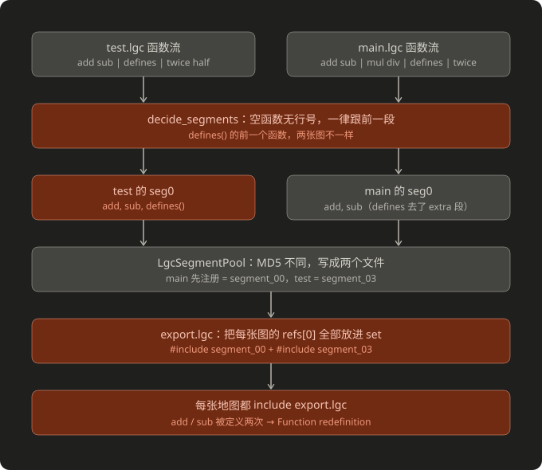

# core/export.lgc 重复引用 segment 0 导致 Function redefinition

## 现象

ASTD 用 `--reorganize` 拆分后重新编译报错：

``` txt
Compile: addon0/default.lgc[ERROR]: Function redefinition,
 in file: .../ASTD/maps/segment_166.lgc at line 13
```

`core/export.lgc` 末尾同时 include 了两份内容几乎一样的 segment 0：

``` c
#include "segment_00.lgc"    // logo 的 segment 0：17 个前置函数 + defines()
#include "segment_166.lgc"   // main / addon0\default 的 segment 0：同样 17 个前置函数，没有 defines()
```

每张地图都 include `export.lgc`，17 个前置函数全部被定义两次。main 和 default 自己的 `segment_169.lgc` 里还有一份 `defines()`，所以它们重复了 18 个。

ASF453、ASLH、ASNE 同样走了拆分流程，却没有报错。

## 复现材料

| 文件夹 | 内容 |
|---|---|
| `source/` | 最小复刻源码，两张地图 `test` / `main`，只用简单的算术函数 |
| `unpacked/` | 编译成 lgd 后，用 `--reorganize` 反编译并拆分得到的结果 |

复现步骤：

1. 把 `source/` 放进 `maps` 文件夹，用 `lgc_compiler.exe` 编译出 `test.lgd` / `main.lgd`
2. 删掉 `.lgc`，运行 `lgd-decompiler maps --reorganize`
3. 重新编译，报错 `Function redefinition ... segment_03.lgc at line 13`

源码结构（`|` 表示文件边界）：

``` txt
test.lgc : common(add sub) | defines(defines)            | state(twice half) | main()
main.lgc : common(add sub) | extra(mul div) | defines(defines) | state(twice half) | main()
```

- `common.lgc`：两张地图都最先 include，拆分后成为 segment 0
- `defines.lgc`：只有一个空函数 `defines()`，对应原工程的 `configuration\defines.lgc`
- `extra.lgc`：只有 main include，对应 ASTD main 比 logo 多 include 的 wait / cacheable / scale 等文件

## 成因



1. **空函数没有行号**：`defines()` 的函数体为空，编译器不会为它生成 `// --- Line N ---`，拆分器无法得知它属于哪个文件。
2. **空函数一律归入前一段**（`decide_segments`）：
   - test：`defines()` 前面是 common 的 `sub`，于是被粘进 segment 0 → `add, sub, defines()`
   - main：`defines()` 前面是 extra 的 `div`，于是被粘进 extra 段 → segment 0 只有 `add, sub`
3. **MD5 去重**（`LgcSegmentPool`）：两个 segment 0 的内容不同，各写成一个文件。main 先注册，得到 `segment_00`；test 得到 `segment_03`。
4. **export.lgc 取并集**（`merge_decompiled_project`）：把每张地图的 `refs[0]` 都放进一个 `set`，再全部 include → `segment_00` 和 `segment_03` 都进了 `export.lgc`。
5. 每张地图都 include `export.lgc` → `add` / `sub` 被定义两次。

## 为什么有时灵有时不灵

空函数归属不一致这件事，4 个 sample 里都有。例如 ASF453 的 `defines()`：logo 里它的前一个函数是 `IsPlayMusic`，main 里是 `setMissionStatus`。

- **普通段不一致**：无害。只是 MD5 对不上、多写出几个 segment 文件，每张地图仍然只 include 自己那一份。
- **segment 0 不一致**：致命。segment 0 不由各地图自己 include，而是统一放进共享的 `export.lgc`，结果所有地图都同时拿到了所有版本。

`export.lgc` 取并集的写法，默认了"所有地图的 segment 0 一字不差"。只有同时满足下面两个条件，这个前提才会被打破：

- 有一个空函数恰好落在 segment 0 的末尾
- 各地图在 segment 0 之后 include 的文件不一样（ASTD 的 logo 比 main 少 include 了 6 个文件）

ASTD 碰上了，另外三个 sample 只是没碰上。

## 为什么"export 只引用 segment_00"修不好

`segment_00` 只是 MD5 池里第一个登记的段，不代表"正确版本"。哪张地图先登记，取决于 `rglob` 的扫描顺序：

- **本复刻**：00 是 main 的 `add, sub`。把 03 注释掉后，test 会丢掉 `defines()`，只是因为它是空函数、也没人调用，才碰巧能编译。
- **ASTD**：00 是 logo 的 `前置函数 + defines()`。main / default 从 `export.lgc → segment_00` 拿到一份 `defines()`，又从自己的 `segment_169` 拿到一份，照样 `Function redefinition`。

## 修复

1. **根因**：`decide_segments` 中，紧挨在行号回跳前面的连续空函数单独成段，不再粘给前一段；其他位置的空函数照旧跟随当前段。它们本来就是独立文件（如 `defines.lgc`），去重后所有地图共用同一个小段，segment 0 自然一致。
2. **命名**：全由空函数组成的段命名为 `segment_XX.empty.lgc`，与普通段共用编号。4 个 sample 分别只多出 4 / 4 / 10 / 10 个这样的文件。
3. **兜底**：`export.lgc` 收集到不止一个 segment 0 版本时，`logger.error` 列出各版本及来源文件，然后 `sys.exit(1)`。
4. **测试**：
   - 单测：`test_lgc_splitter.py`（空函数在边界、段中间、末尾三种情况，以及 ASTD 场景复刻）、`test_segment_merger.py`（`.empty.lgc` 命名、多版本退出）
   - 回归：`tests/regression/test_segment0_duplicate_regression.py`，fixture 为本目录 `source/` 编译出的 `tests/fixtures/lgd_files/segment0_duplicate/{test,main}.lgd`

验证：4 个 sample 的 `export.lgc` 都只 include 一个 segment 0；ASF453 / ASLH / ASNE 拆分后完整编译通过。ASTD 不再报 `Function redefinition`，但会卡在另一个早已存在的反编译问题（`__DUMMY_ARG__` 导致 `invalid operation for array: %`），未拆分的 `main.bak.lgc` 同样会报这个错，与本 bug 无关。

## 相关代码

- `src/lgd_tool/lgd_decompiler/LGC_reorganizer/func_processor.py`：`decide_segments`（空函数归属）、`LgcSegmentPool`（MD5 去重与命名）
- `src/lgd_tool/lgd_decompiler/LGC_reorganizer/reorganizer.py`：`merge_decompiled_project` 中 `segment_0_files = set()`（commit `9b55534` 引入）
